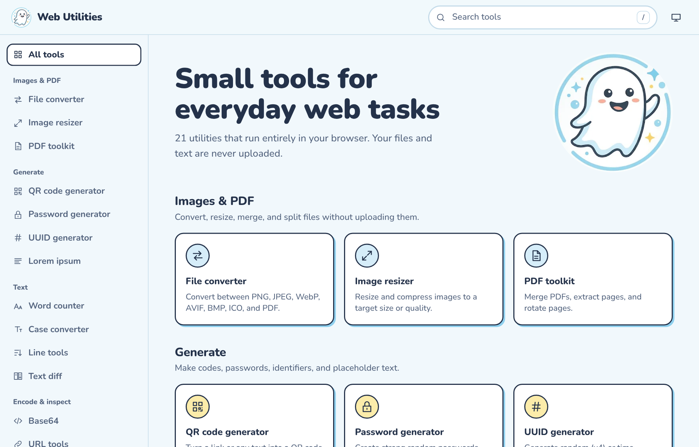
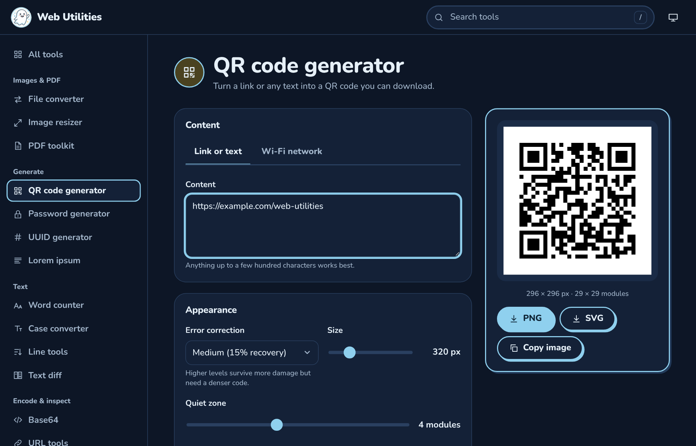

<p align="center">
  
</p>

<h1 align="center">Web Utilities</h1>

<p align="center">
  Small, private tools for everyday web tasks. Everything runs in your browser, so your files and text never leave your device.
  https://hyrumhendrickson.github.io/WebUtilities/
</p>

<p align="center">
  <a href="https://github.com/YOUR-USERNAME/web-utilities/actions/workflows/ci.yml"></a>
  <a href="LICENSE"></a>
  
  
</p>

<p align="center">
  
  
</p>

## Features

Web Utilities is plain HTML, CSS, and JavaScript. There is no framework, no bundler, no account, and no server.

| Category         | Tools                                                                                                                       |
| ---------------- | --------------------------------------------------------------------------------------------------------------------------- |
| Images & PDF     | **File converter** (PNG, JPEG, WebP, BMP, ICO, PDF), **Image resizer**, **PDF toolkit** (merge, extract, rotate)            |
| Generate         | **QR codes** (links, text, Wi-Fi), **Passwords**, **UUIDs** (v4, v7), **Lorem ipsum**                                       |
| Text             | **Word counter**, **Case converter**, **Line tools** (sort, dedupe), **Text diff**                                          |
| Encode & inspect | **Base64**, **URL tools**, **Hashes** (SHA family), **JWT decoder**, **JSON formatter**, **Regex tester**, **Browser info** |
| Convert          | **Timestamps**, **Colors** (with WCAG contrast), **Units**                                                                  |

Highlights:

- **Private by design.** No uploads, no analytics, no third-party requests. A strict Content Security Policy blocks network access to other origins.
- **Works offline.** After the first visit a service worker caches the app, so it keeps working without a connection.
- **Any image or PDF to any other.** Convert images to PDF, PDF pages to images, or combine a mix of both into a single PDF. Multiple outputs download as one ZIP.
- **Accessible.** Keyboard navigation, visible focus, screen reader labels, light and dark themes, and reduced-motion support.
- **Installable.** It ships a web app manifest, so browsers can install it as an app.

## Quick start

You need [Node.js](https://nodejs.org) 20.19 or later, only for the local development server and checks.

```bash
git clone https://github.com/YOUR-USERNAME/web-utilities.git
cd web-utilities
npm install
npm start
```

Open <http://localhost:8080>. The app uses ES modules and a Content Security Policy, so it must be served over HTTP(S). Opening `index.html` directly from disk (`file://`) does not work. Any static server is fine:

```bash
python3 -m http.server 8080
```

## Browser support

Current versions of Chrome, Edge, Firefox, and Safari. Some capabilities depend on the browser:

- **WebP and AVIF output** are offered only when the browser can encode them. AVIF encoding is not available in most browsers today, so the option usually does not appear.
- **HEIC and HEIF** images can be read only by browsers that decode them natively (Safari).
- **Copy image** in the QR tool needs the asynchronous Clipboard API.

## Privacy and security

- Files are read with the File API and processed in memory. They are never sent anywhere.
- Passwords and UUIDs use `crypto.getRandomValues`. Hashes use `SubtleCrypto`.
- The Content Security Policy in `index.html` allows resources only from the same origin.
- All DOM content is built with text nodes. The linter forbids `innerHTML`.
- The JWT decoder shows token contents but does **not** verify signatures.
- MD5 is intentionally omitted: browsers do not provide it, and it is unsuitable for integrity checks.

See [SECURITY.md](SECURITY.md) to report a vulnerability.

## Project structure

```text
index.html              App shell and Content Security Policy
sw.js                   Service worker (offline support)
css/                    Design tokens, base layout, components
js/
  main.js               Router, navigation, search, theme
  registry.js           Tool metadata and lazy loaders
  ui.js, icons.js       DOM helpers and icon set
  media.js              Image and PDF decoding, encoding, assembly
  results.js            Shared download list with ZIP support
  lib/                  Pure logic with no DOM access (unit tested)
  tools/                One module per tool
vendor/                 Pinned third-party browser libraries
assets/                 Logo, icons, font
tests/                  Node test suites
docs/                   Architecture and contributor guides
scripts/                Dev server and vendor sync
```

Read [docs/ARCHITECTURE.md](docs/ARCHITECTURE.md) for how the pieces fit together.

## Development

| Command               | What it does                                               |
| --------------------- | ---------------------------------------------------------- |
| `npm start`           | Serve the app at <http://localhost:8080>                   |
| `npm test`            | Run unit tests with the built-in Node test runner          |
| `npm run lint`        | Lint with ESLint                                           |
| `npm run format`      | Format with Prettier                                       |
| `npm run check`       | Lint, format check, vendor check, and tests (what CI runs) |
| `npm run vendor:sync` | Refresh vendored libraries from `node_modules`             |

To add a tool, follow [docs/ADDING_A_TOOL.md](docs/ADDING_A_TOOL.md).

## Deployment

The site is static, so any host works. The included workflow in `.github/workflows/pages.yml` publishes to GitHub Pages:

1. In your repository, open **Settings → Pages** and set **Source** to **GitHub Actions**.
2. Push to `main`. The workflow runs the checks and deploys.

All paths are relative, so the app works from a sub-path such as `https://YOUR-USERNAME.github.io/web-utilities/`.

## Contributing

Contributions are welcome. Please read [CONTRIBUTING.md](CONTRIBUTING.md) and the [Code of Conduct](CODE_OF_CONDUCT.md) first. If you use an AI coding agent, point it at [AGENTS.md](AGENTS.md).

## Credits

Web Utilities builds on these open-source projects. Full notices are in [THIRD_PARTY_NOTICES.md](THIRD_PARTY_NOTICES.md).

- [qrcode-generator](https://github.com/kazuhikoarase/qrcode-generator) by Kazuhiko Arase (MIT)
- [pdf-lib](https://github.com/Hopding/pdf-lib) by Andrew Dillon (MIT)
- [PDF.js](https://github.com/mozilla/pdf.js) by Mozilla (Apache-2.0)
- [Nunito](https://github.com/googlefonts/nunito) by The Nunito Project Authors (SIL OFL 1.1)

QR Code is a registered trademark of DENSO WAVE INCORPORATED.

## License

[MIT](LICENSE)
